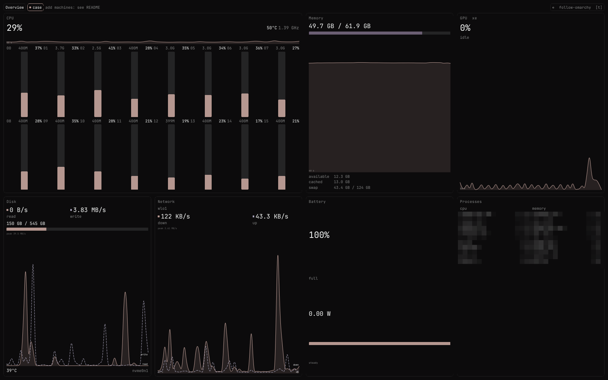

# Mainframe

[](https://github.com/Aragorn2046/omarchy-mainframe/actions/workflows/ci.yml)

**A beautiful, theme-aware system monitor for [Omarchy](https://omarchy.org).** Every core, memory, GPU, disk,
network, battery and your busiest apps, on one screen, at once. Other machines get a tab. No 1991 terminal look.



## Why

Omarchy ships `btop`, which is powerful but looks like a terminal from another era. Task-manager style apps make you
click between CPU, memory and GPU pages. Mainframe shows everything you care about in equal tiles on a single
screen, and it wears your Omarchy theme: switch themes and Mainframe follows within two seconds.

## Features

- **Every logical core** as its own meter with its percentage (a compact heat-map mode exists for 32+ cores)
- **CPU** total, package temperature, frequency and history
- **Memory** used / available / cached and swap, with history
- **GPU** busy % and frequency from the kernel driver (code paths for Intel `xe`, Intel `i915` and AMD `amdgpu`;
  NVIDIA shows "not supported")
- **Disk** read / write rates, root filesystem usage, drive temperature
- **Network** download / upload with history, per interface
- **Battery** charge, state and power draw (hidden gracefully on desktops)
- **Top apps** by live CPU and by memory, grouped by name (`chromium ×42`)
- **Follows your Omarchy theme live**, dark and light, using your Omarchy font
- **Other machines as tabs.** Point Mainframe at an SSH host and it gets the same cards. Nothing is installed on that
  machine, and nothing keeps running there after you close the window. A small usage index remains in the remote user’s `~/.cache/mainframe`. When the connection closes, the remote sampler
  detects the loss and stops its helper processes before exiting.
- **Light**: about 2% of one CPU core and ~180 MB RAM while open on a real Wayland session (measured on a 16-thread laptop); nothing runs when it is
  closed. No root, no daemons, no compiled code: plain QML, JavaScript and Python.

## Styles

Choose Classic (the default) or Cyberpunk in settings. Cyberpunk follows the active theme. Each switch defaults to on and can be turned off independently.

- **HUD frames:** corner brackets and uppercase headings.
- **Neon glow:** soft highlights under chart lines and on meter edges.
- **Grid backdrop:** a static grid and scanline texture.
- **Display font:** Orbitron headings and large figures, with a monospace fallback.
- **Segmented meters:** LED-style bars.
- **Data animations:** step changing figures, meters and new chart points.
- **Title glitch:** briefly shifts card headings at intervals.
- **Scanline sweep:** occasionally moves a thin line across the window.
- **Pulsing status dots:** changes indicator opacity with each sample.
- **Boot sequence:** shows a short opening screen. Press any key or click to skip it.

## Requirements

- Omarchy (Arch Linux + Hyprland), which already includes Quickshell (`qs`) and Python 3
- Linux `/proc` and `/sys` (that's it)

## Tested on

One machine: an Omarchy laptop with an Intel Core Ultra (16 threads), Intel Arc graphics (`xe` driver), an NVMe
drive and a battery. The `i915`, `amdgpu`, many-core, SATA/eMMC and no-battery paths are written and unit-tested
with sample data, but have not run on real hardware. This is shared as-is, so others can pick it up and adapt it.

Not yet tested on AMD hardware. If you run Mainframe on an AMD CPU or GPU, please open an issue with a screenshot.

## Install

```bash
git clone https://github.com/Aragorn2046/omarchy-mainframe.git ~/.local/share/omarchy-mainframe
~/.local/share/omarchy-mainframe/install.sh
```

The installer links `~/.config/quickshell/mainframe` to the cloned `mainframe/` folder. It replaces only an older
Mainframe link or a broken link at that path, and refuses anything else (a real folder, a file, or a link to another
app). Run it:

```bash
env -u QT_QPA_PLATFORMTHEME qs -c mainframe
```

This skips Omarchy's GTK platform theme plugin, which Mainframe does not need for its dashboard and which slows startup.

### Put it on a key

Add this to `~/.config/hypr/bindings.lua` (this example replaces Omarchy's btop key, Super+Ctrl+T):

```lua
hl.unbind("SUPER + CTRL + T")
o.bind("SUPER + CTRL + T", "Activity", "omarchy-launch-or-focus mainframe 'uwsm-app -- env -u QT_QPA_PLATFORMTHEME qs -c mainframe'")
```

Press the key again to bring an open Mainframe window to the front instead of opening a second one.

### Update

```bash
git -C ~/.local/share/omarchy-mainframe pull --ff-only
```

Close and reopen Mainframe to load the new version.

### Uninstall

```bash
~/.local/share/omarchy-mainframe/uninstall.sh && rm -rf ~/.local/share/omarchy-mainframe
```

The uninstaller removes only the Mainframe link (or a broken link at that path); the folder is deleted only if that
succeeds. Remove the key binding from `bindings.lua` if you added one.

## Keys

| Key | Action |
|---|---|
| `Left` / `h` | Previous tab; close Storage while Storage is open |
| `Right` / `l` / `Ctrl+Tab` / `Ctrl+PgDown` | Next tab; inactive while Storage is open |
| `Ctrl+Shift+Tab` / `Ctrl+Backtab` / `Ctrl+PgUp` | Previous tab; inactive while Storage is open |
| `1` / `2` / `3` / `4` / `5` / `6` / `7` / `8` / `9` | Select the corresponding tab |
| `s` / `d` / `a` | Select Systems, Storage, or Agents in Overview |
| `Tab` / `Shift+Tab` / `Backtab` | Cycle Overview views |
| `Backspace` / `Alt+Left` | Close Storage while Storage is open, or go back from a machine tab |
| `Down` / `j` / `Up` / `k` | Scroll one step; pick a row while Storage is open |
| `PgDown` / `Space` / `PgUp` / `Shift+Space` | Scroll one page |
| `Home` / `g` / `End` / `G` | Jump to the top or bottom |
| `Enter` / `Return` | Open the selected row in the folder viewer while Storage is open |
| `?` / `F1` | Toggle keyboard help |
| `Escape` | Close help, settings, Storage, or the window |
| `q` / `Q` | Close Storage while Storage is open, or close the window |
| `t` / `T` | Open the theme picker |
| `r` / `R` | Refresh Agents or restart the current machine collector |
| `,` / `Ctrl+,` | Open settings; Ctrl+, also closes settings |

`Right`, `l`, `Ctrl+Tab`, `Ctrl+Shift+Tab`, `Ctrl+Backtab`, `Ctrl+PgUp`, and `Ctrl+PgDown` are inactive while Storage is open. The help overlay scrolls with the scroll keys listed above.

## How it works

`mainframe/shell.qml` is a Quickshell app that opens one normal Hyprland window. A small Python sampler
(`mainframe/collect.py`) reads `/proc` and `/sys` once per second and streams compact JSON to the window. It exits
with the window (parent-death signal plus end-of-input), so nothing is left running. Colours come from
`~/.local/state/omarchy/current/theme/colors.toml`, the same file the Omarchy shell uses.

## Development

The smoke idle CPU gates disable the usage scan and gate the scan separately.

```bash
node --test mainframe/tests/        # unit tests for the metrics logic
scripts/mainframe-smoke.sh                    # headless load, layout, CPU and cleanup checks
MAINFRAME_SMOKE_LIVE=1 scripts/mainframe-smoke.sh   # also measures CPU on a real window (opens it for ~40 s)
```

## Value at API prices

The Agents page estimates the API value of Claude Code and Codex token usage on this machine and configured SSH machines. It includes input, output and cache tokens from recent local transcripts. Public Anthropic and OpenAI API list prices are stored in `mainframe/prices.json`; the date and source appear in that file. You can override individual model rates in `~/.config/mainframe/prices.json` using the same provider and model structure. This is an estimate, and subscription fees are not included. Unknown prices and machines that have not reported make the result partial. The scan checks `~/.claude/projects`, `~/.claude-accounts/*/projects`, `$CLAUDE_CONFIG_DIR/projects` when set, `~/.config/claude/projects`, `~/.codex/sessions`, and `$CODEX_HOME/sessions` when set. Index version 8 rebuilds the previous usage index on the next scan.

## Monitor your other machines

Mainframe watches the computer it is running on. To keep an eye on another one, open settings with `,` and add its name and SSH alias.
You can also edit `$XDG_CONFIG_HOME/mainframe/hosts.json` (that is `~/.config/mainframe/hosts.json` when
`XDG_CONFIG_HOME` is unset):

```json
{
  "hosts": [
    {"name": "Host A", "ssh": "host-a"},
    {"name": "Host B", "ssh": "host-b"},
    {"name": "Host C", "ssh": "host-c"}
  ]
}
```

Each `ssh` value is the Host alias from your SSH config, the same name you would pass to `ssh`.
The name is the tab label. Mainframe re-reads this file when it changes. A missing or unreadable
file leaves you with this machine only, and a small "add machines: see README" hint.

Requirements: key login to that host (`BatchMode`, no password prompt) and `python3` on the host.
Mainframe does not install anything there and does not open a port. While a remote tab is selected
it runs `ssh … exec python3 -u - --remote` and sends its own sampler on stdin. Switch away and that
connection stays up for a minute, so coming back is instant, then it closes. Closing the window
stops every connection. A laptop that is asleep or away shows "Can't reach …" and is tried again
every 30 seconds while its tab is open.

What you see depends on the host:

- **Linux** uses the same `/proc` numbers as this machine, including GPU and temperatures when the
  host exposes them.
- **macOS** shows per-core CPU, memory, swap, disk throughput, root disk usage, network, battery and
  the busiest processes. GPU and temperatures need root, so those cards say "n/a". The process CPU
  figure is the decayed average `ps` already reports.
- **WSL** (a Linux kernel that says `microsoft` or `WSL`) shows Windows host memory and CPU when PowerShell is available, with a WSL memory breakdown.
  If the Windows sample fails, the card falls back to WSL figures. The GPU usually shows "n/a".

A sensor the host cannot provide says "n/a". It does not take the rest of the cards down with it.

## Related

[mainframe-cpp](https://github.com/jrimmer/mainframe-cpp) by Jason Rimmer ports the sampler to C++ and keeps these screens; it starts faster and uses less memory.

## Contributing

Mainframe is a community project: issues, fixes, hardware support and design ideas are welcome. See
[CONTRIBUTING.md](CONTRIBUTING.md). Please report security problems privately ([SECURITY.md](SECURITY.md)).

## License

MIT

### Overview and agent usage

Overview has Systems, Storage and Agents views. Collectors run independently for all machines while Overview is open. Select a machine card to open its dashboard.

Add accounts in settings. Claude and Codex use the Omarchy collectors with the account directory and an isolated cache. A command account accepts a JSON array of arguments and must print one usage JSON record. Its limit `percent` values use 0–100 (for example, `55` means 55%); Omarchy collector and usage-file values use fractions from 0–1. Mainframe never reads provider credentials. Records refresh when stale, every ten minutes while Agents is open, and on `r`. Existing Omarchy usage files also appear. Unavailable providers are hidden unless enabled in Display settings.

For usage files, Mainframe decides the scale per record. If any valid `percent` value in a record is above 1, the whole record is read as 0–100; otherwise every value is read as a fraction from 0–1. So a 0–100 file whose values are all 1 or less (for example `0.5` meaning half a percent) would be shown as 50%, which is why your own usage files should always write fractions, like Omarchy's helpers do.

A usage JSON file can set `category` to `llm`, `video`, `image`, `voice`, or `other` to choose its section in Agents. The value is case-insensitive; without it, Mainframe infers the section from the provider, ID, or name.

Mainframe stores settings, hosts and accounts under `$XDG_CONFIG_HOME/mainframe/`. Account records use `$XDG_CACHE_HOME/mainframe/agents/`. Storage reports mounted filesystems and Windows drives when available.

Run the offline view checks with `python3 mainframe/tests/v16-smoke.py`. They use temporary XDG directories and fixture hosts.
